# Home Lab Case Study: Segmented Network Foundation

---

## Overview

I built a fully virtualized network lab (no physical routers, switches, or access points) using VMware Workstation and pfSense CE, to practice the routing, segmentation, and firewall troubleshooting skills that underlie the largest single category of help desk tickets: connectivity issues. The lab simulates a small organization with two isolated network segments (Staff and Guest) behind a single firewall, plus a dedicated management path that stays reachable no matter what gets misconfigured elsewhere.

## Objective

Reproduce, entirely in software, the network foundation a help desk or desktop support role depends on day to day: routed, segmented subnets with their own DHCP scopes, firewall-enforced isolation between them, and the diagnostic muscle memory for the DHCP, DNS, and access issues that generate real tickets.

## Architecture

The firewall (pfSense CE) runs four virtual network interfaces: a WAN uplink to the internet, a LAN interface reserved exclusively for management access to the firewall's own configuration, and two additional interfaces, Staff (10.10.10.0/24) and Guest (10.10.20.0/24), each on its own isolated virtual network with its own subnet and DHCP scope.

The LAN-as-management design was a deliberate choice, not the default. An earlier version of the plan repurposed the LAN interface itself as one of the two segments being tested. I changed that after recognizing a real operational risk: pfSense automatically protects only the interface named LAN with a built-in rule guaranteeing web GUI access, so reconfiguring firewall rules and IP addressing on that same interface risked locking myself out mid-change. Separating "the network I'm actively experimenting on" from "the path I use to fix it if I break it" is a pattern used in real production environments for exactly this reason, and applying it here turned a convenience into a design decision worth explaining in an interview.

**Basic routing, verified before firewall policy was layered on top:** once both OPT interfaces were addressed, I confirmed pfSense was routing between the two new segments at the IP layer before adding any firewall rules, using a Staff-side client reaching Guest's gateway address directly:

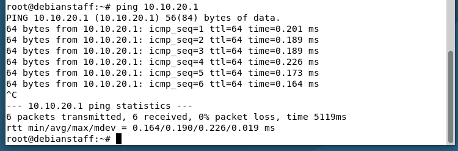

*Staff client reaching the Guest interface's gateway address (10.10.20.1), confirming pfSense was routing between the two new segments before any firewall policy was applied.*

**DHCP scopes**, one per segment plus the untouched LAN range, each issuing leases independently:

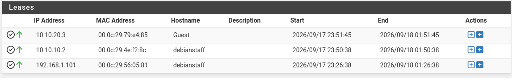

*Active leases across all three segments (Guest, Staff, and the LAN management network), confirming each interface's DHCP server is scoped correctly and issuing to the expected clients.*

Each test client also demonstrates holding two addresses at once on the same interface: a static assignment used for early connectivity testing, and a DHCP-issued secondary address picked up once the interface's DHCP server was verified:

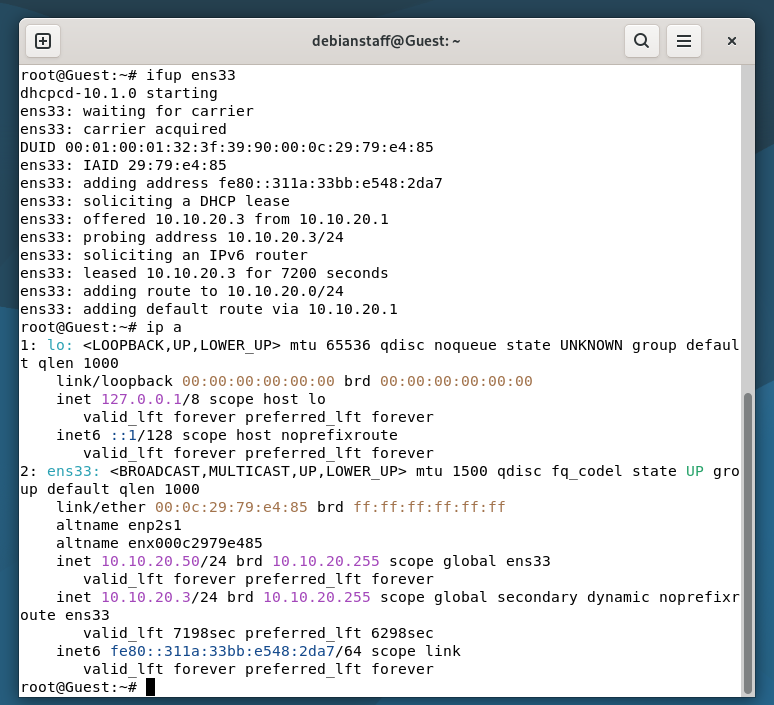

*Guest client bringing up its interface, negotiating a DHCP lease (10.10.20.3), and retaining its earlier static address (10.10.20.50) as a secondary, both live on the same NIC.*

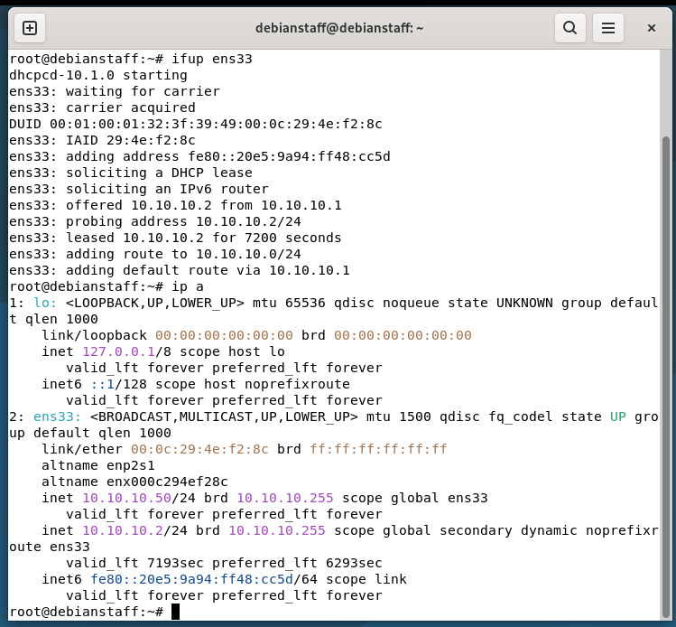

*Same pattern on the Staff client: DHCP-leased 10.10.10.2 alongside a static secondary address, confirming the DHCP scope and static addressing coexist without conflict.*

## Network Segmentation

Once Staff and Guest had static addressing and their own DHCP scopes, the remaining piece was a firewall policy that keeps the two segments from reaching each other by default: the same pattern used in real environments to keep a guest Wi-Fi network away from internal systems, or one department's devices isolated from another's.

The policy itself is a simple, ordered pair of rules on each interface: a rule that explicitly denies traffic destined for the other segment, evaluated *before* a general rule that allows everything else out to the internet. The order is what makes it work: the deny rule has to sit above the general allow, or it never gets a chance to act.

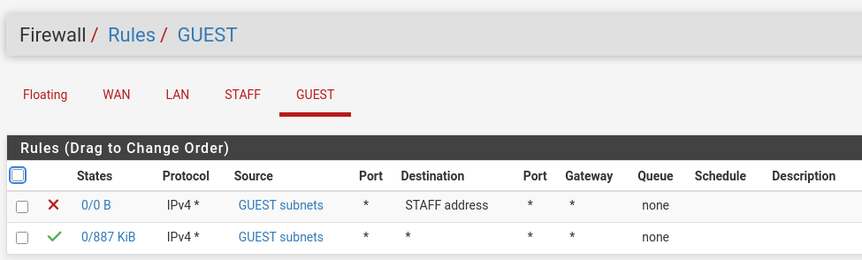

*Guest interface's segmentation policy: a deny rule targeting the Staff segment, evaluated first, followed by a general allow rule for everyday traffic.*

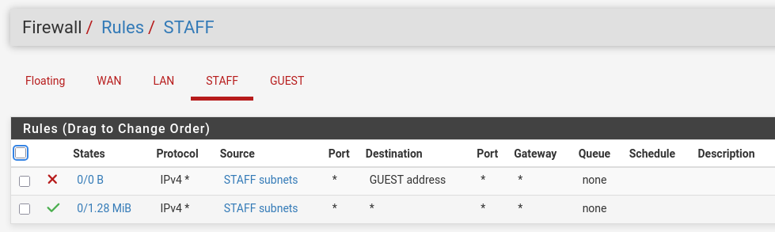

*The mirrored policy on the Staff interface.*

With this pair of rules in place on both interfaces, Staff and Guest can each reach the internet independently while remaining walled off from one another: the foundational control that the rest of the lab builds on.

## Troubleshooting Highlight 1: Interfaces Start With Zero Rules

Getting to that policy wasn't automatic, and the gap in between is worth documenting on its own. After building the two segments, Staff and Guest could obtain DHCP leases but had no route to the internet at all. Investigation showed that pfSense's automatic "allow this network out" rule only applies to the interface literally named LAN. Newly created interfaces start with zero rules, meaning no traffic passes in or out by default, segmentation or otherwise. Rather than solving this with a single broad "allow everything" rule (which would have silently undone the segmentation shown above), I added the general allow rule only after the deny rule was already in place on each interface, restoring everyday connectivity without ever opening a gap between Staff and Guest.

## Troubleshooting Highlight 2: A Narrow Exception, and a Hidden Rule-Scope Bug

Later, I needed one specific Staff host to reach one specific Guest host without giving up segmentation for every other device on either network: a realistic scenario (e.g., a help desk workstation needing access to a specific guest-network kiosk for support purposes). The correct approach is a narrow exception, not a blanket change: I added a host-to-host allow rule, scoped to those two exact addresses, placed *above* the existing block rule rather than editing the block rule itself.

*Confirming the Staff test host's address (10.10.10.150) via its active DHCP lease before troubleshooting further.*

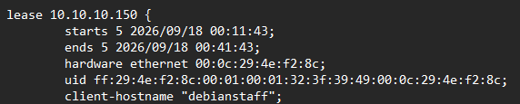

*Cross-checking the same lease directly in the DHCP server's lease file, tying the hostname to the address being used in the exception rule.*

Despite the new rule appearing correctly scoped and correctly ordered, the initial re-test still failed in both directions:

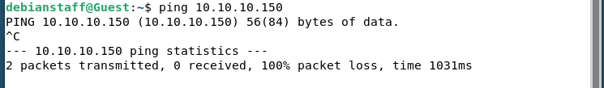

These two failed tests are worth pausing on, because they're doing double duty: on their own, a Staff host and a Guest host failing to reach each other is exactly the proof-of-segmentation this lab set out to produce back in Step 4. The deny policy was, in fact, stopping ordinary cross-segment traffic. The problem was narrower than "segmentation isn't working"; it was that *this specific exception* wasn't taking effect on top of it.

Rather than guessing further, I used each rule's built-in state/byte counters (a running total of traffic that has actually matched that rule) to see what was really happening. The new exception rule showed zero traffic matched, meaning the problem was upstream of the rule's own logic. Reviewing the general block rule directly above it (the same deny rule built back in Step 4) turned up the real issue: its destination field was scoped to the object type **"address"** (which matches only pfSense's own interface IP) rather than **"subnets"** (which matches actual client traffic). The two options sit right next to each other in the same dropdown and look almost identical at a glance, but produce very different firewalls: one blocks a single address that real client traffic rarely touches directly, the other blocks the whole segment behind that interface. In other words, the Step 4 policy had been under-scoped since it was first written; it just hadn't been exercised by a test specific enough to expose it. Ordinary Staff and Guest hosts still failed their reachability tests for the right reason (segmentation-by-default plus the exception not yet matching), which is why the bug went unnoticed until this point.

After correcting both interfaces' block rules to the proper subnet scope, the ruleset was re-verified:

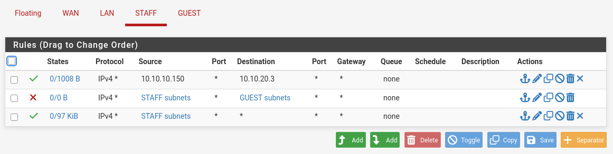

*Staff interface, Step 4's segmentation policy now corrected and extended: row 1 is the new host-specific exception rule (evaluated first, so it takes effect before the segmentation rule below it ever gets a chance to block this one pair); row 2 is Step 4's original deny rule, now properly scoped to "subnets" instead of "address"; row 3 is Step 4's original general allow rule that restores everyday internet access.*

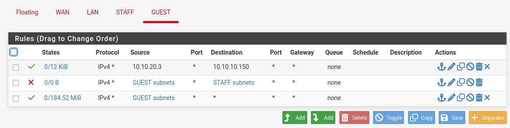

*The mirrored, corrected ruleset on the Guest interface: same three-rule structure, same fix applied.*

With the fix applied, the test passed cleanly in both directions:

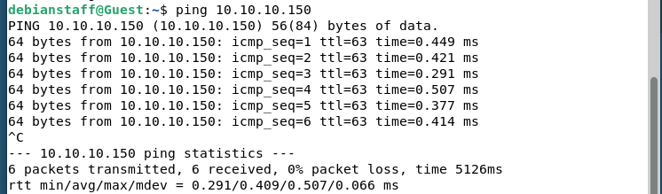

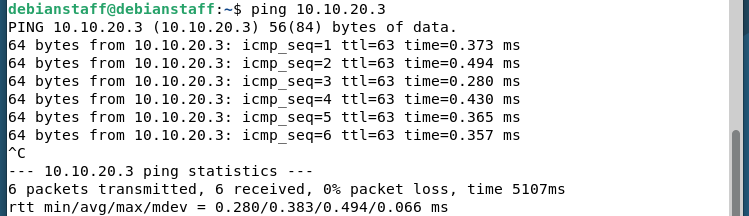

The per-rule traffic counters confirmed this wasn't a coincidence: the specific exception rule showed non-zero traffic matching exactly this host pair, while the general block rule remained untouched at zero, proof that segmentation was intact for every other host, and the exception applied only where intended.

## Step 8: DNS Failure Diagnosis

Step 8 of the build plan reproduces one of the most common help desk tickets: a user who reports that "the internet is down" when only name resolution is broken. From the user's side the two failures look identical, because every website stops loading, but they are diagnosed very differently. To recreate it, I deliberately pointed the Staff client at a DNS resolver that does not exist, then worked the problem the way a support technician would: separate IP connectivity from name resolution first, then prove the failure on the wire with a packet capture.

**Breaking DNS on purpose.** On the Staff client, the resolver configuration normally points at pfSense's own DNS resolver (10.10.10.1), which the DHCP server hands out automatically. I edited `/etc/resolv.conf` so the nameserver entry pointed at 10.255.255.254, an address nothing answers on:

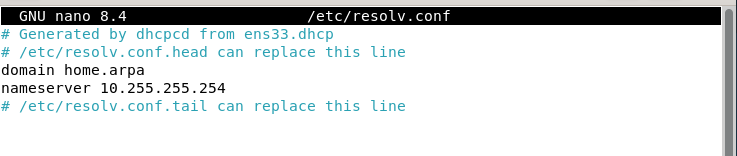

*The Staff client's resolver file after the change, with the nameserver set to an unreachable address.*

**Working the symptom in layers.** The first question for any "I can't get online" ticket is whether the problem is the network or the name lookup. Testing by IP address and by name separates the two immediately:

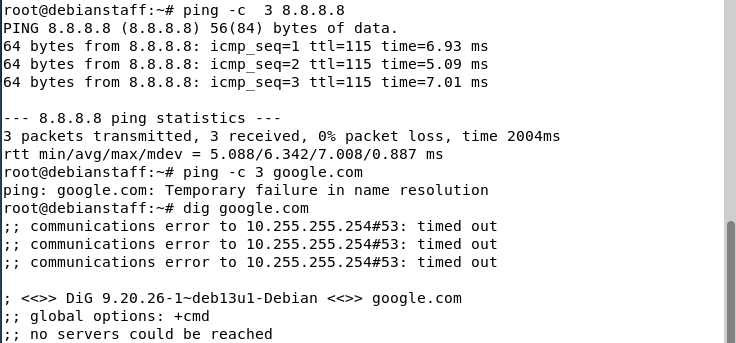

*Pinging 8.8.8.8 succeeds (3 of 3 packets), so the path to the internet is fine. Pinging google.com fails with "Temporary failure in name resolution," and dig times out against 10.255.255.254 and reports "no servers could be reached."*

Working by IP address while names fail is the signature of a DNS problem rather than a connectivity problem, and it rules out the firewall rules, the routing, and the WAN uplink in a single step.

**Proving it on the wire.** To capture evidence rather than rely on error messages, I ran a packet capture on the Staff interface in pfSense (Diagnostics, then Packet Capture), filtered to UDP port 53 and the client's IP address, and then ran `dig google.com` from the client:

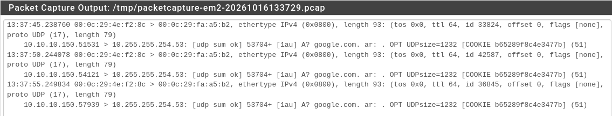

*The same query (ID 53704) leaves the client three times, five seconds apart, addressed to 10.255.255.254 on port 53. No response ever comes back.*

The five-second spacing is the client's default resolver timeout, and each retry uses a new source port but carries the same query ID. The capture shows exactly what the error message implied: the client is asking, and nothing is answering.

**Fixing it and confirming.** I restored the nameserver entry to 10.10.10.1, the address pfSense's DHCP server normally hands out, and repeated the same tests:

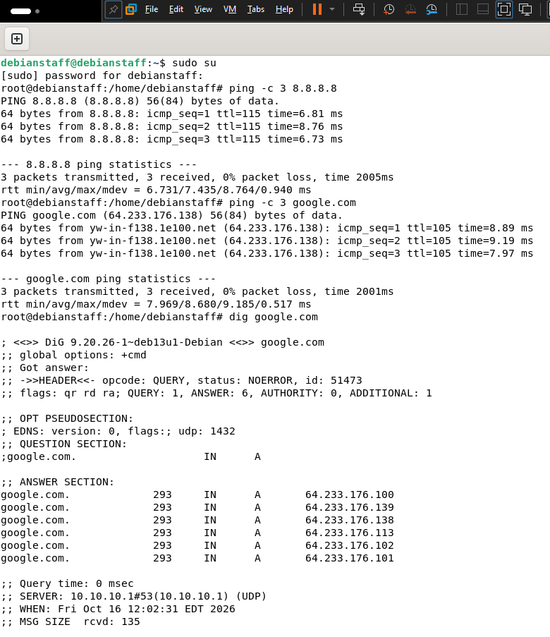

*Ping by name now resolves google.com and succeeds, and dig returns NOERROR with six A records, answered by server 10.10.10.1.*

I then repeated the packet capture with the identical filter, so the two captures are a fair comparison:

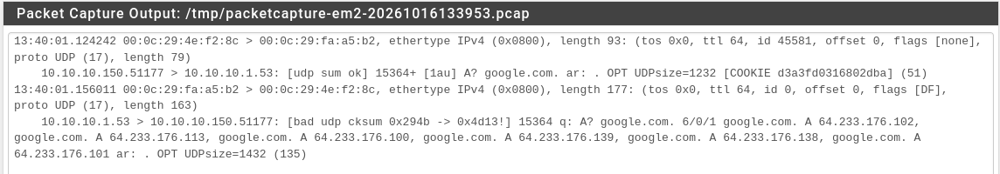

*One query from the client to 10.10.10.1, and a response about 32 milliseconds later with a matching query ID (15364) and port, carrying the six answers.*

One detail worth knowing when reading this capture: the response line is flagged "bad udp cksum." That is a capture artifact, not a fault. pfSense records its own outgoing packets before the network card calculates the checksum (checksum offload), and the client accepted the answer, as the successful dig shows.

The pair of captures is the heart of the exercise. In the broken state, queries go out and no replies come back; in the fixed state, every query is followed by a matching response. The same ladder (ping by IP, ping by name, dig, then capture) works on any "websites won't load" ticket.

## Skills Demonstrated

Virtual network segmentation design and implementation (VLAN-equivalent, fully software-defined); firewall rule authoring, ordering, and troubleshooting, including diagnosing a subtle object-scope misconfiguration ("address" vs. "subnets") using per-rule traffic counters rather than guesswork; DHCP scope configuration and multi-address interface verification; DNS failure diagnosis using layered connectivity tests and packet capture analysis; and structured technical documentation, including an as-built reference, change log, and incident records maintained throughout the build rather than reconstructed after the fact.
